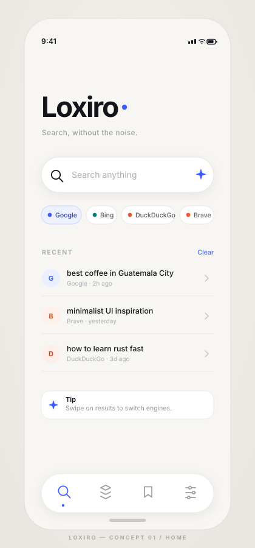

# Loxiro — Project Plan

> **Status:** Draft v0.1 — planning only, no application code yet
> **Date:** 2026-10-24
> **Working name:** Loxiro
> **One-liner:** A calm, mobile-first search app that puts one beautiful box between you and the whole web.

---

## 0. TL;DR

We are **not** rebuilding Chromium. Loxiro is a **search companion**: a mobile-first, installable web app (PWA) that feels like the best part of a browser — the new tab, the address bar, the instant answer — with none of the clutter. One search field, multiple engines, and a genuinely well-designed interface.

The first deliverable is a **polished, clickable UI prototype** with realistic sample results, real engine links, working local history/saved items, and a complete design system. No backend, no API keys, no tracking.



*Concept board 01 — Home screen. Created as an editable SVG so the visual direction stays version-controlled and text-crisp.*

---

## 1. Vision

**The problem:** Searching on mobile is noisy. Browser apps bury the search bar under tabs, cards, news feeds, and suggestions you didn't ask for. Switching engines means retyping the same query. Private engines are hidden behind settings.

**The idea:** Loxiro opens directly into a single, focused search moment. Type once, choose (or swipe to) any engine, get clean results. Everything else — recents, saved pages, settings — stays one tap away and out of the way.

**The feeling:** Quiet. Fast. Precise. The interface should feel like a well-made tool, not a content feed.

**Positioning:**

| | Chrome / Safari | DuckDuckGo / Brave | Perplexity / Arc Search | **Loxiro** |
|---|---|---|---|---|
| Full browser | ✅ | partial | ❌ | ❌ (v0.1) |
| Multi-engine switching | ❌ | ❌ | ❌ | ✅ |
| AI answers | partial | partial | ✅ | later |
| Minimalist, design-first UI | ❌ | ➖ | ➖ | ✅ |
| Mobile-first PWA | ➖ | ✅ | ✅ | ✅ |
| No tracking, local-only state | ❌ | ✅ | ❌ | ✅ |

**Non-goals for v0.1:** a rendering engine, tabs, extensions, accounts, sync, ads, real search APIs, LLM calls, analytics, payments, native app stores.

---

## 2. Decisions already locked

| # | Decision | Choice | Rationale |
|---|---|---|---|
| 1 | **Core product** | Mobile-first app, installable as a PWA | Fastest path to something you can actually use on your phone; no app-store friction. |
| 2 | **Search capability** | Multi-engine search | One query, Google / Bing / DuckDuckGo / Brave — switch without retyping. |
| 3 | **First build scope** | Polished UI prototype | Validate the design and interaction feel before wiring up paid APIs. |
| 4 | **Tech stack** | Agent's recommendation (see §9) | Modern, lightweight, zero backend. |
| 5 | **Backend** | None in v0.1 | Everything runs locally in the browser. |

Anything not listed here is still open — see §12.

---

## 3. Product principles

1. **One thing on screen.** The search field is the hero. Every other element earns its place or gets cut.
2. **Thumb-first.** Primary actions live in the bottom half of the screen. Nothing important requires a two-hand stretch.
3. **Speed is a feature.** Instant transitions, no spinners where a skeleton will do, no blocking network calls.
4. **Privacy by default.** No accounts, no analytics, no network requests except links the user explicitly opens.
5. **Quiet visual language.** Neutral paper, one accent color, hairline borders, generous whitespace. Color is a signal, not decoration.
6. **Keyboard-friendly too.** Even though it's mobile-first, `Enter`, `/`, `Esc`, and arrow keys work on desktop.
7. **Honest prototype.** Sample results are clearly labeled demo data, but every result can open the real engine in one tap.

---

## 4. Users & jobs to be done

**Primary user:** Someone who searches dozens of times a day on their phone, values speed and privacy, and is tired of bloated browser start pages.

| Job | Current friction | Loxiro answer |
|---|---|---|
| Look something up quickly | Browser start page is full of distractions | App opens straight into a focused search field |
| Compare results across engines | Retype the query in each engine | Switch engine chips; the query is preserved |
| Search privately | Settings buried in menus | DuckDuckGo / Brave are one tap away |
| Return to a previous search | Lost in browser history | Clean, local recent list |
| Keep a useful result | Buried in bookmarks | One-tap save, dedicated Saved tab |

---

## 5. Scope — v0.1 prototype

### In scope ✅

- **Home screen** — wordmark, tagline, single search field, engine chips, recent searches, bottom navigation.
- **Suggestions** — as-you-type suggestions from a static dataset, keyboard/history matches, debounced.
- **Results screen** — sample organic results with title, domain, favicon, snippet, and engine badge.
- **Engine switching** — tap a chip or swipe horizontally on the results list; query is preserved.
- **Real search bridge** — an "Open in Google/Bing/…" action builds a real search URL and opens it in a new tab. No API key needed.
- **Recents** — persisted in `localStorage`, clearable individually or all at once.
- **Saved** — bookmark results locally, remove them, empty state.
- **Settings** — theme (light / dark / system), default engine, show/hide recents, reduce motion, clear all data.
- **States** — loading skeletons, empty states, no-results, offline notice, error fallback.
- **Themes** — full light and dark palettes driven by CSS variables.
- **Responsive** — 360px phone → 1440px desktop (centered app column, keyboard shortcuts enabled).
- **PWA** — manifest, icons, installable, offline app shell.
- **Motion** — subtle, 180–240ms transitions; fully disabled under `prefers-reduced-motion`.

### Out of scope ❌

Real search API results in-app, AI-generated answers, accounts/sync, browser tabs or a webview renderer, extensions, push notifications, ads, analytics, native iOS/Android builds, payments.

> **Deliberate hybrid:** in-app results are clearly marked **demo data**, but the "Open in engine" links are real. So the prototype is honest *and* genuinely useful from day one.

---

## 6. Screens & information architecture

```
┌─────────────────────────────────────────┐
│  Home (idle)                            │
│  ├─ tap search ──> Home (typing)        │
│  │                  └─ suggestion list  │
│  ├─ submit ───────> Results             │
│  │                  ├─ engine chips     │
│  │                  ├─ result list      │
│  │                  ├─ result preview   │  (bottom sheet)
│  │                  └─ open in engine ──┼─> external tab
│  ├─ Recent item ──> Results (re-run)    │
│  └─ bottom nav                          │
│       ├─ Search  (Home)                 │
│       ├─ Spaces  (placeholder teaser)   │
│       ├─ Saved                          │
│       └─ Settings                       │
└─────────────────────────────────────────┘
```

| Screen | Layout | Key states |
|---|---|---|
| **Home — idle** | Wordmark top-third, search field centered, engine chips below, recent list, floating bottom nav | Empty recents, recents present, dark theme |
| **Home — typing** | Search field lifts to top, keyboard visible, suggestion list replaces content | 0 / 1 / many suggestions, history matches highlighted |
| **Results** | Sticky compact search bar, engine chips, results count, result cards, "open in engine" primary action | Loading skeleton, results, no results, offline |
| **Result preview** | Bottom sheet with larger snippet, domain, save button, open button | Loading, saved / unsaved |
| **Saved** | Simple list with domain grouping, remove actions, search-within-saved | Empty, populated |
| **Settings** | Grouped rows: Appearance, Search, Data, About | Theme picker sheet, engine picker sheet, confirm-clear dialog |
| **Spaces** | Intentional teaser: "Collections are coming" — keeps the nav honest without fake features | Static |

---

## 7. Visual design system

### Direction: "Quiet precision"

Swiss-influenced minimalism: a strict spacing grid, one typeface family, hairline borders instead of heavy shadows, and a single accent color used only for active/primary states. Warm neutral paper rather than clinical pure white.

### Color tokens

| Token | Light | Dark | Use |
|---|---|---|---|
| `--paper` | `#F7F6F2` | `#0C0D10` | App background |
| `--surface` | `#FFFFFF` | `#15161B` | Cards, sheets, nav |
| `--ink` | `#14151A` | `#F2F2F4` | Primary text |
| `--muted` | `#6E6F74` | `#9A9BA1` | Secondary text |
| `--faint` | `#A9AAAE` | `#6E6F75` | Placeholders, labels |
| `--line` | `#E7E6E1` | `#26272D` | Hairline borders |
| `--accent` | `#3B5BFF` | `#7E92FF` | Active state, links, focus |
| `--accent-soft` | `#EDF0FF` | `#1B2140` | Active chip / selected row |
| `--danger` | `#D64545` | `#FF7A7A` | Destructive actions |

Engine identity colors (dots only, never large fills): Google `#4285F4`, Bing `#008373`, DuckDuckGo `#DE5833`, Brave `#FB542B`.

### Typography

- **Font:** `Inter` (variable) with `system-ui` fallback. Wordmark uses the same family at weight 650 with `-0.04em` tracking — no custom logotype needed for v0.1.
- **Scale:** 11 / 12 / 14 / 16 / 20 / 28 / 46 px.
- **Rules:** max two weights per screen (400/500 for body, 600/650 for headings), uppercase labels at 10.5px with `0.15em` tracking, line-height 1.45 for body.

### Spacing, radius, elevation

- 4px base grid: `4, 8, 12, 16, 24, 32, 48, 64`.
- Radius: `12` cards, `16` sheets, `999` pills/chips, `32` floating nav.
- Elevation: one soft shadow (`0 4px 16px rgba(20,21,26,.07)`) on the search field and bottom nav only. Everywhere else, a 1px `--line` border.

### Motion

| Interaction | Duration | Easing | Effect |
|---|---|---|---|
| Field focus lift | 220ms | `ease-out` | Search bar translates up 8px, chips fade in |
| Results enter | 200ms | `ease-out` | Staggered fade + 6px translate, 30ms per item |
| Engine switch | 240ms | `ease-out` | Horizontal slide + crossfade of result list |
| Bottom sheet | 260ms | spring-ish | Translate from bottom + backdrop fade |
| Chip press | 120ms | `ease-out` | Scale to 0.96 |

All motion collapses to instant opacity changes under `prefers-reduced-motion: reduce`.

### Components to build

`SearchField`, `EngineChip`, `EnginePickerSheet`, `SuggestionList`, `ResultCard`, `ResultSkeleton`, `BottomNav`, `IconButton`, `SegmentedControl`, `BottomSheet`, `EmptyState`, `Toast`, `ThemeToggle`, `SettingRow`, `Hairline`, `ScreenHeader`.

### Do / Don't

- ✅ Do: use whitespace as the main layout tool; keep the accent color rare; align everything to the 4px grid; keep text crisp at 1x.
- ❌ Don't: add gradients, glassmorphism, decorative blobs, stock photos, emoji in the UI, multiple accent colors, or fake news/feed cards.

---

## 8. Key interactions

1. **Open app → cursor already in the search field** (mobile keyboard raises on tap; desktop auto-focuses).
2. **Type → suggestions appear** after 120ms debounce; history matches are marked with a clock icon.
3. **Enter / tap suggestion → results screen** with skeletons for ~350ms, then results.
4. **Switch engine → query preserved**, results animate, active chip updates, recents record the engine used.
5. **Swipe left/right on results → previous/next engine** (the "cool" detail; mirrored by chips for accessibility).
6. **Tap a result → bottom sheet preview** with Save and "Open in <engine>" actions.
7. **Long-press / swipe a recent row → remove**; "Clear" removes all with an undo toast.
8. **`/` focuses search**, `Esc` clears and returns home, `↑/↓` navigate suggestions, `Enter` submits.
9. **Offline → still works**: sample data is bundled; external links simply won't load.

---

## 9. Technical architecture

### Recommended stack

| Layer | Choice | Why |
|---|---|---|
| Framework | **React 19 + TypeScript (strict)** | Component model fits the design system; types keep the engine registry safe. |
| Build | **Vite** | Instant dev server, tiny production bundle. |
| Styling | **Tailwind CSS + CSS variables** | Utility speed plus a single source of truth for light/dark tokens. |
| Motion | **Motion (framer-motion)** | Declarative, accessible transitions without hand-rolled CSS. |
| Icons | **Lucide React** | Consistent 1.75px line icons matching the visual language. |
| Routing | **Hash-based state routing** (no router dep in v0.1) | 4 screens only; keeps the bundle small and deep-links simple. |
| Persistence | **`localStorage` via a typed `useLocalStorage` hook** | Zero backend; versioned keys with a migration guard. |
| Testing | **Vitest + Testing Library** | Unit-test the URL builder, engine registry, storage, and one component. |
| PWA | **`vite-plugin-pwa`** (Phase 4) | Manifest, icons, offline shell with minimal config. |

**Total runtime dependencies:** React, Motion, Lucide. Everything else is dev tooling. No backend, no database, no env secrets.

### Folder structure

```
Loxiro/
├── docs/
│   ├── PROJECT_PLAN.md              ← this file
│   └── assets/
│       └── loxiro-concept.svg       ← visual north star
├── public/
│   ├── icons/                      ← PWA icons (192, 512, maskable)
│   └── manifest.webmanifest
├── src/
│   ├── app/
│   │   ├── App.tsx                 ← screen switcher + providers
│   │   ├── ThemeProvider.tsx
│   │   └── router.ts               ← hash ↔ screen state
│   ├── components/
│   │   ├── ui/                     ← SearchField, Chip, Sheet, Button…
│   │   └── features/               ← ResultCard, EngineChips, RecentList…
│   ├── screens/
│   │   ├── HomeScreen.tsx
│   │   ├── ResultsScreen.tsx
│   │   ├── SavedScreen.tsx
│   │   ├── SettingsScreen.tsx
│   │   └── SpacesScreen.tsx
│   ├── data/
│   │   ├── engines.ts              ← engine registry
│   │   ├── sampleResults.ts        ← curated demo data
│   │   └── suggestions.ts          ← static suggestion corpus
│   ├── hooks/
│   │   ├── useLocalStorage.ts
│   │   ├── useDebounce.ts
│   │   ├── useTheme.ts
│   │   └── useSearch.ts
│   ├── lib/
│   │   ├── searchUrl.ts            ← real engine URL builder
│   │   ├── storage.ts              ← versioned keys
│   │   └── cn.ts
│   ├── styles/
│   │   ├── tokens.css              ← CSS variables, light + dark
│   │   └── index.css               ← Tailwind + base
│   └── types/
│       └── index.ts
├── index.html
├── package.json
├── tsconfig.json
├── vite.config.ts
└── README.md
```

### Core data model

```ts
export type EngineId = 'google' | 'bing' | 'duckduckgo' | 'brave'; // + 'perplexity' later
export type Theme = 'light' | 'dark' | 'system';

export interface Engine {
  id: EngineId;
  name: string;
  color: string;                       // dot color only
  searchUrl: (query: string) => string;
}

export interface SearchResult {
  id: string;
  title: string;
  url: string;
  domain: string;
  snippet: string;
  faviconSeed: string;                 // deterministic local avatar, no network
  engine: EngineId;
}

export interface RecentSearch {
  id: string;
  query: string;
  engine: EngineId;
  createdAt: number;
}

export interface SavedItem extends SearchResult {
  savedAt: number;
}

export interface Settings {
  theme: Theme;
  defaultEngine: EngineId;
  showRecents: boolean;
  reduceMotion: boolean;
}
```

### The search bridge (no API key required)

```ts
export const ENGINES: Engine[] = [
  { id: 'google',     name: 'Google',      color: '#4285F4',
    searchUrl: q => `https://www.google.com/search?q=${encodeURIComponent(q)}` },
  { id: 'bing',       name: 'Bing',        color: '#008373',
    searchUrl: q => `https://www.bing.com/search?q=${encodeURIComponent(q)}` },
  { id: 'duckduckgo', name: 'DuckDuckGo',  color: '#DE5833',
    searchUrl: q => `https://duckduckgo.com/?q=${encodeURIComponent(q)}` },
  { id: 'brave',      name: 'Brave',       color: '#FB542B',
    searchUrl: q => `https://search.brave.com/search?q=${encodeURIComponent(q)}` },
];
```

External links always open with `target="_blank" rel="noopener noreferrer"`.

### Sample data strategy

- 4–5 curated queries with 8 hand-written results each (so the first demo feels real).
- A **deterministic generator** for any other query: it derives plausible titles/domains from the query text so no search ever dead-ends.
- Results are labeled `Demo results` in the UI. This label disappears automatically once a real API is connected in a later phase.

### Storage keys

`loxiro:v1:settings`, `loxiro:v1:recents`, `loxiro:v1:saved`. A version prefix lets us migrate or wipe cleanly later. No PII ever leaves the device.

---

## 10. Roadmap

| Phase | Name | What ships | Done when |
|---|---|---|---|
| **0** | **Alignment** ✅ | This plan + concept board | You approve the direction |
| **1** | **Shell** | Vite + React + TS scaffold, design tokens, ThemeProvider, app shell, 4-tab bottom nav, hash routing | App opens, tabs switch, light/dark works, no console errors |
| **2** | **Search loop** | Home, engine registry + chips, suggestions, results screen, sample data, engine switching, "open in engine" links | Type → suggest → results → switch engine → open real Google in a new tab |
| **3** | **Memory** | Recents, saved, settings, persistence, clear/undo, empty states | Reload keeps recents, saved items, and theme |
| **4** | **Feel** | Motion, skeletons, offline/error states, a11y pass, responsive desktop layout, PWA manifest + icons | Full DoD checklist below passes; installable on phone |
| **5** | **Decide next** | Evaluate real search API (Brave Search API / Serper / Google CSE), AI answers, Spaces, native wrapper | Written recommendation + cost/complexity comparison |

Phases 1–2 can ship together as the first reviewable build. Phases 3–4 are polish. Phase 5 is a decision gate, not a promise.

---

## 11. Definition of done — v0.1 prototype

- [ ] Works from 360px phone up to 1440px desktop without horizontal scroll.
- [ ] Light and dark themes both pass WCAG AA contrast for body text.
- [ ] Every screen and sheet is reachable; no dead buttons (Spaces shows an honest teaser).
- [ ] Any typed query returns results; engine switching preserves the query.
- [ ] Recents, saved items, and settings survive a full reload.
- [ ] "Open in engine" opens the correct real URL in a new tab.
- [ ] Loading, empty, no-results, and offline states all have designed UI.
- [ ] All interactive elements ≥ 44×44px touch targets; visible focus rings; labeled icons.
- [ ] `prefers-reduced-motion` removes all non-essential animation.
- [ ] Zero runtime network requests except user-initiated external links.
- [ ] No TypeScript errors, no console warnings, no `any` in `src/`.
- [ ] Vitest suite covers `searchUrl.ts`, storage, and `ResultCard`.
- [ ] Lighthouse (mobile): Performance ≥ 90, Accessibility ≥ 95, Best Practices ≥ 95.
- [ ] `README.md` documents setup (`npm install`, `npm run dev`, `npm run build`) and the demo-data disclaimer.
- [ ] Live preview URL shared for review (Vercel deploy is an option since it's connected).

---

## 12. Risks & mitigations

| Risk | Impact | Mitigation |
|---|---|---|
| "It's just another search box" | Weak differentiation | Distinctive wordmark, swipe-to-switch engines, meticulous spacing, tight microcopy. The design *is* the feature in v0.1. |
| Prototype feels fake | Lost trust | Label demo results clearly, but make external engine links real and instant. |
| Multi-engine logic spreads everywhere | Hard to extend | Single `engines.ts` registry + pure `searchUrl` builder; no engine-specific `if` statements in components. |
| Scope creep toward a real browser | Timeline blows up | Explicit non-goals (§1) and a decision gate at Phase 5. |
| Dark theme looks like an afterthought | Quality drop | Tokens defined for both themes from day one in Phase 1, not retrofitted. |
| External font / asset loading slows first paint | Perf hit | Self-host Inter variable font, inline critical CSS, use local favicon seeds instead of remote favicons. |
| `localStorage` unavailable (private mode) | Crash | Storage hook wraps all access in try/catch with an in-memory fallback. |

---

## 13. Open questions — your call

1. **Confirm the pivot:** are you happy with a **search companion PWA** rather than a full browser shell with tabs? *(Default: yes — this plan assumes it.)*
2. **Engine list:** keep Google / Bing / DuckDuckGo / Brave, or add **Perplexity** (AI answers) as a 5th chip in the prototype?
3. **Default engine:** Google (familiar) or DuckDuckGo (privacy-forward)? *(Default: DuckDuckGo, to match the privacy principle.)*
4. **Themes:** ship **both** light and dark in v0.1, or light-only first? *(Default: both — tokens make it cheap.)*
5. **Spaces tab:** keep it as an honest "coming soon" teaser, or drop to a 3-tab nav for maximum minimalism? *(Default: 3 tabs — cleaner.)*
6. **Tagline:** "Search, without the noise." — keep, or do you have another phrase in mind?
7. **Brand mark:** plain type wordmark for now, or should I design a small custom symbol/logo alongside it?

---

## 14. Immediate next step

Reply with **"build it"** (plus any answers to §13 you care about) and I'll scaffold **Phase 1 + 2**: the full design-token system, app shell, Home screen, engine chips, suggestions, results screen, and a live preview you can open on your phone.

If you'd rather adjust the plan first, tell me what to change and I'll revise this document before writing any application code.
